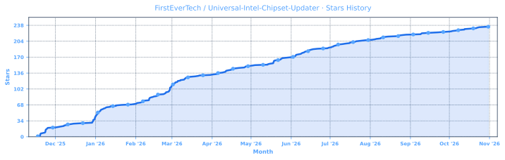
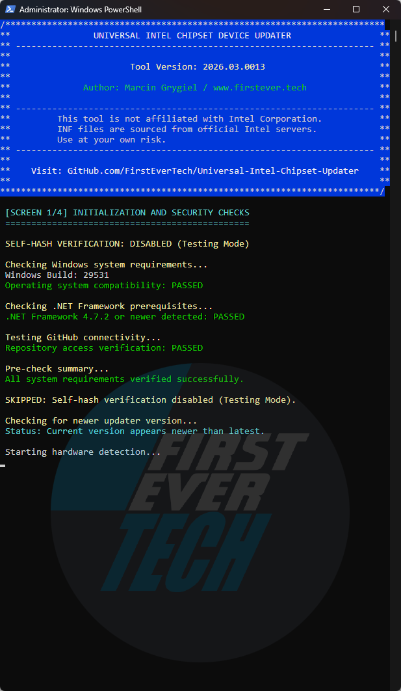
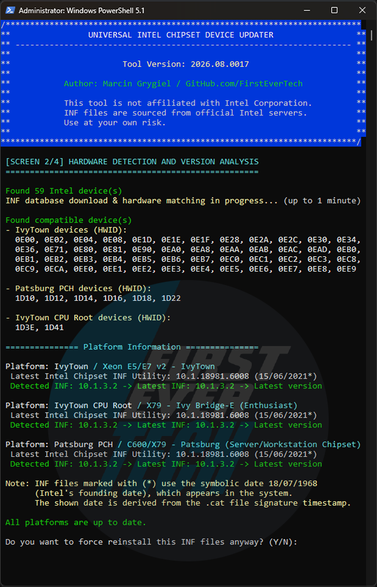
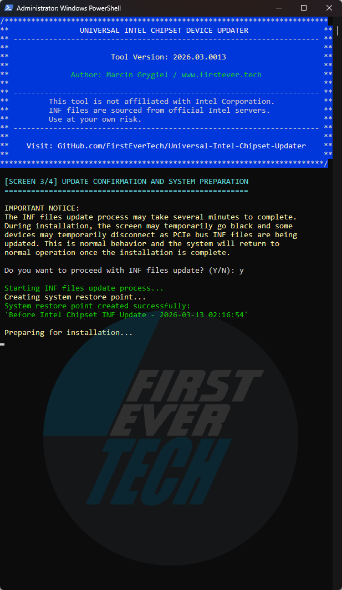
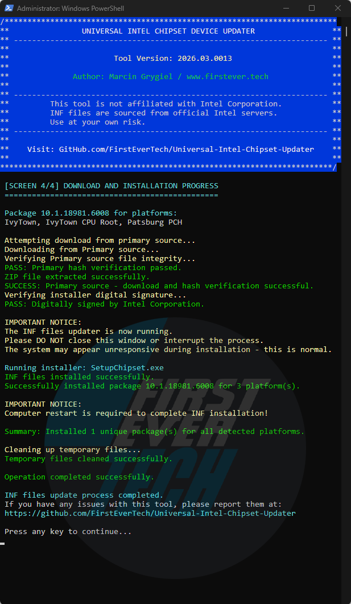

<p align="left">
  <a href="README.md">🇬🇧 English</a> |
  <a href="https://translate.google.com/translate?sl=en&tl=pl&u=https://github.com/FirstEverTech/Universal-Intel-Chipset-Updater">🇵🇱 Polski</a> |
  <a href="https://translate.google.com/translate?sl=en&tl=de&u=https://github.com/FirstEverTech/Universal-Intel-Chipset-Updater">🇩🇪 Deutsch</a> |
  <a href="https://translate.google.com/translate?sl=en&tl=fr&u=https://github.com/FirstEverTech/Universal-Intel-Chipset-Updater">🇫🇷 Français</a> |
  <a href="https://translate.google.com/translate?sl=en&tl=es&u=https://github.com/FirstEverTech/Universal-Intel-Chipset-Updater">🇪🇸 Español</a> |
  <a href="https://translate.google.com/translate?sl=en&tl=pt&u=https://github.com/FirstEverTech/Universal-Intel-Chipset-Updater">🇧🇷 Português</a> |
  <a href="https://translate.google.com/translate?sl=en&tl=nl&u=https://github.com/FirstEverTech/Universal-Intel-Chipset-Updater">🇳🇱 Nederlands</a>
  <br>
  <a href="README_CN.md">🇨🇳 简体中文</a> |
  <a href="https://translate.google.com/translate?sl=en&tl=ja&u=https://github.com/FirstEverTech/Universal-Intel-Chipset-Updater">🇯🇵 日本語</a> |
  <a href="https://translate.google.com/translate?sl=en&tl=ko&u=https://github.com/FirstEverTech/Universal-Intel-Chipset-Updater">🇰🇷 한국어</a> |
  <a href="https://translate.google.com/translate?sl=en&tl=it&u=https://github.com/FirstEverTech/Universal-Intel-Chipset-Updater">🇮🇹 Italiano</a> |
  <a href="https://translate.google.com/translate?sl=en&tl=tr&u=https://github.com/FirstEverTech/Universal-Intel-Chipset-Updater">🇹🇷 Türkçe</a> |
  <a href="https://translate.google.com/translate?sl=en&tl=ar&u=https://github.com/FirstEverTech/Universal-Intel-Chipset-Updater">🇸🇦 العربية</a> |
  <a href="https://translate.google.com/translate?sl=en&tl=hi&u=https://github.com/FirstEverTech/Universal-Intel-Chipset-Updater">🇮🇳 हिन्दी</a> |
  <a href="https://translate.google.com/translate?sl=en&tl=ru&u=https://github.com/FirstEverTech/Universal-Intel-Chipset-Updater">🇷🇺 Русский</a>
</p>

<a id="top"></a>
# 🚀 **通用 Intel 芯片组设备更新器**

[](https://github.com/FirstEverTech/Universal-Intel-Chipset-Updater/releases)[](https://www.microsoft.com/windows)[](https://learn.microsoft.com/en-us/powershell/scripting/install/install-powershell-on-windows?view=powershell-7.5)[](https://dotnet.microsoft.com/en-us/download/dotnet-framework)[](https://github.com/FirstEverTech/Universal-Intel-Chipset-Updater/releases)[](https://github.com/FirstEverTech/Universal-Intel-Chipset-Updater)  
[](LICENSE)[](https://www.powershellgallery.com/packages/universal-intel-chipset-device-updater)[](https://github.com/FirstEverTech/Universal-Intel-Chipset-Updater/blob/main/AI_AUDITS.md)[](https://www.virustotal.com/gui/url/3bb0eb76124abed930e0b00792e4102e9a8884348dc1ba0e47b0437f374462c8?nocache=1)[](https://github.com/FirstEverTech/Universal-Intel-Chipset-Updater/issues)

<a href="https://github.com/FirstEverTech">
  
</a>

## 🔧 自动化你的 Intel 芯片组更新

**通用 Intel 芯片组设备更新器**是一款先进、注重安全的工具，能自动检测你的 Intel 硬件，并以企业级安全措施安装最新的官方芯片组 **INF 文件**。

这个项目是人类专业知识与 AI 辅助工具务实协作的产物。

### 这个工具为什么存在

Intel 官方的芯片组设备软件经过 25 年的演变，已经变成一个复杂、臃肿的软件包。这个工具通过自动检测并只安装你的系统真正需要的 INF 文件来简化这个过程——不多也不少。

---

[](https://www.intel.com/content/www/us/en/search.html#q=inf)[](https://github.com/FirstEverTech/Universal-Intel-Chipset-Updater/blob/main/data/intel-chipset-infs-latest.md)[](https://github.com/FirstEverTech/Universal-Intel-Chipset-Updater/blob/main/data/intel-chipset-infs-latest.md)[](https://github.com/FirstEverTech/Universal-Intel-Chipset-Updater/blob/main/data/intel-chipset-infs-latest.md)

详细的文档与指南，请参阅：
→ **[关于 Intel 芯片组设备软件的完整真相](https://github.com/FirstEverTech/Universal-Intel-Chipset-Updater/blob/main/docs/THE-WHOLE-TRUTH-ABOUT_EN_2026.md)**（[简体中文](docs/THE-WHOLE-TRUTH-ABOUT_CN_2026.md)）
→ **[项目幕后：诞生记](https://github.com/FirstEverTech/Universal-Intel-Chipset-Updater/blob/main/docs/BEHIND-THE-PROJECT_EN_2025.md)**（[简体中文](docs/BEHIND-THE-PROJECT_CN_2025.md)）
→ **[INF 选择与 SetupAPI 驱动排名模型](https://github.com/FirstEverTech/Universal-Intel-Chipset-Updater/blob/main/docs/INF-SELECTION-SETUPAPI-RANKING-MODEL_EN_2026.md)**（[简体中文](docs/INF-SELECTION-SETUPAPI-RANKING-MODEL_CN_2026.md)）
→ **[通过 MDM 部署通用 Intel 芯片组设备更新器](https://github.com/FirstEverTech/Universal-Intel-Chipset-Updater/blob/main/docs/MDM-DEPLOYMENT-GUIDE_EN_2026.md)**（[简体中文](docs/MDM-DEPLOYMENT-GUIDE_CN_2026.md)）
→ **[如何亲自验证最新的 INF 文件](https://github.com/FirstEverTech/Universal-Intel-Chipset-Updater/blob/main/docs/HOW-TO-VERIFY-INF_EN_2026.md)**（[简体中文](docs/HOW-TO-VERIFY-INF_CN_2026.md)）

👉 [分享你的反馈！](https://github.com/FirstEverTech/Universal-Intel-Chipset-Updater/discussions)

---

## 💖 支持这个项目

**通用 Intel 芯片组设备更新器**是免费开源的——由一名独立开发者维护。
硬件 ID 数据库需要持续更新，跨硬件世代的兼容性测试正在进行中，新功能也一直在开发。

[](https://www.patreon.com/c/firstevertech/membership)[](https://github.com/sponsors/FirstEverTech)[](https://www.paypal.com/donate/?hosted_button_id=48VGDSCNJAPTJ)[](https://buymeacoffee.com/firstevertech)[](https://ko-fi.com/firstever)

如果这个工具为你节省了时间、改善了设备识别，或帮助老硬件继续运行——请考虑支持开发。🎯 **[在 Patreon 免费关注](https://www.patreon.com/FirstEverTech)** —— 及时了解新版本和开发进展。

## 🏢 赞助商

_暂无赞助商——[成为第一个并加入你的公司广告！](https://www.patreon.com/c/firstevertech/membership)_

## ❤️ 支持者

衷心感谢所有支持者——你们的贡献意义重大。
你的名字也可以出现在这里。每一份帮助都能覆盖开发成本，并确保这些工具持续改进。
<!-- SUPPORTERS_START -->
- Sqania, jadeanemail, westor7, J. A. Dean, Bartechr, tsantaliki, PegHorse
<!-- SUPPORTERS_END -->

## ⭐ 星标

如果这个项目帮助了你，请在 GitHub 页面顶部点击 "Star" 按钮。



## 🌐 社区与分发

- 论坛官方帖子：
  🔗 **[TechPowerUp](https://www.techpowerup.com/forums/threads/tool-universal-intel-chipset-device-updater.346086/)**, **[Guru3D](https://forums.guru3d.com/threads/universal-intel-chipset-device-updater-open-source.460882)**, **[WinClub](https://winclub.pl/topic/49717-universal-intel-chipset-device-updater)**, **[ElevenForum](https://www.elevenforum.com/t/universal-intel-chipset-device-updater.41790)**, **[Win-Raid](https://winraid.level1techs.com/t/tool-universal-intel-chipset-device-updater)**, 以及 **[Station-Drivers](https://www.station-drivers.com/index.php/en/forum/intel-chipsets-drivers/887-universal-intel-chipset-drivers-updater)**。

- 为透明度和额外验证，项目还收录于：
  🔗 **[SourceForge](https://sourceforge.net/projects/universal-intel-chipset)**, **[Softpedia](https://www.softpedia.com/get/System/Universal-Intel-Chipset-Device-Updater.shtml)**, **[MajorGeeks](https://www.majorgeeks.com/files/details/universal_intel_chipset_device_updater.html)**, 和 **[Instalki](https://www.instalki.pl/download/programy/sterowniki/plyty-glowne/intel/universal-intel-chipset-device-updater/)**。

## 💼 职业机会

> [!TIP]
> **我专注于 Windows 部署、驱动自动化、硬件兼容性、Microsoft 技术、基础设施分析和定制 IT 工具。如果你的组织面临自动化、部署、设备管理或驱动管理方面的挑战，让我们一起探讨我能提供的帮助。**
>
> 🔗 **商务联系：** [firstever.tech/contact](https://www.firstever.tech/contact)
> 🔗 **LinkedIn 主页：** [linkedin.com/in/marcin-grygiel](https://linkedin.com/in/marcin-grygiel)

---

<a id="table_of_contents"></a>
## 📑 **1. 目录**

1. [**目录**](#table_of_contents)
2. [**版本亮点**](#release-highlights)
   2.1 [最新版本](#latest-version)
   2.2 [上一版本](#previous-releases)
   2.3 [更早版本](#older-releases)
3. [**AI 审计报告**](#ai-audit-reports)
4. [**应用概述**](#application-overview)
5. [**核心功能**](#key-features)
   5.1 [智能硬件检测](#smart-hardware-detection)
   5.2 [多层安全](#multi-layer-security)
   5.3 [无缝操作](#seamless-operation)
   5.4 [全面覆盖](#comprehensive-coverage)
6. [**系统要求**](#system-requirements)
   6.1 [系统要求表](#system-requirements-table)
   6.2 [Windows 版本支持](#windows-version-support)
   6.3 [旧系统说明](#legacy-system-notes)
7. [**快速对比**](#quick-comparison)
8. [**快速开始**](#quick-start)
   8.1 [方法 1：一键运行](#method-1-one-click-execution)
   8.2 [方法 2：直接运行 PowerShell](#method-2-powershell-direct)
   8.3 [方法 3：仅硬件 ID 扫描器](#method-3-hardware-id-scanner-only)
   8.4 [方法 4：PowerShell Gallery](#method-4-powershell-gallery)
   8.5 [命令行选项](#command-line-options)
9. [**工作原理**](#how-it-works)
   9.1 [自校验与更新检查](#self-verification-update-check)
   9.2 [硬件检测](#hardware-detection)
   9.3 [数据库查询与匹配](#database-query-matching)
   9.4 [安全验证](#security-verification)
   9.5 [安装与清理](#installation-cleanup)
10. [**安全优先的方法**](#security-first-approach)
    10.1 [已验证的安全层次](#verified-security-layers)
11. [**使用场景**](#usage-scenarios)
    11.1 [家庭用户](#home-users)
    11.2 [IT 专业人员与技术员](#it-professionals-technicians)
    11.3 [系统组装商](#system-builders)
12. [**下载选项**](#download-options)
    12.1 [选项 1：SFX 可执行文件（推荐）](#option-1-sfx-executable-recommended)
    12.2 [选项 2：脚本包](#option-2-script-bundle)
    12.3 [选项 3：PowerShell Gallery](#option-3-powershell-gallery)
    12.4 [选项 4：源代码](#option-4-source-code)
13. [**项目结构**](#project-structure)
14. [**发布结构**](#release-structure)
    14.1 [主要文件](#primary-files)
    14.2 [校验文件](#verification-files)
    14.3 [文档](#documentation)
15. [**常见问题（FAQ）**](#frequently-asked-questions-faq)
    15.1 [这个工具安全吗？](#is-this-tool-safe-to-use)
    15.2 [它会更新我所有的 Intel 驱动吗？](#will-this-update-all-my-intel-drivers)
    15.3 [有什么风险？](#what-are-the-risks)
    15.4 [文件下载到哪里？](#where-are-files-downloaded)
    15.5 [如果出了问题怎么办？](#what-if-something-goes-wrong)
    15.6 [自动更新检查是如何工作的？](#how-does-the-automatic-update-check-work)
    15.7 [自哈希校验是做什么的？](#what-does-self-hash-verification-do)
    15.8 [更新如何通知？](#how-are-updates-notified)
    15.9 [为什么证书"不受信任"？](#why-is-the-certificate-not-trusted)
    15.10 [为什么 VirusTotal 对 SFX 可执行文件有检出？](#why-does-virustotal-show-detections)
16. [**Intel 平台支持**](#intel-platform-support)
17. [**性能指标**](#performance-metrics)
    17.1 [典型执行时间分解](#typical-execution-times)
    17.2 [磁盘空间占用](#disk-space-usage)
    17.3 [内存（RAM）占用](#memory-ram-usage)
    17.4 [资源占用汇总](#resource-usage-summary)
18. [**已知问题**](#known-issues)
19. [**准备好更新了吗？**](#ready-to-update)
    19.1 [快速开始指南](#quick-start-guide)
    19.2 [验证步骤（可选）](#verification-steps-optional)
    19.3 [需要帮助？](#need-help)
20. [**贡献**](#contributing)
21. [**许可证**](#license)
22. [**致谢**](#acknowledgments)
23. [**重要链接**](#important-links)
24. [**作者与联系方式**](#author-and-contact)

[↑ 返回顶部](#top)

---

<a id="release-highlights"></a>
## 🎉 **2. 版本亮点**

<a id="latest-version"></a>
### 2.1 最新版本

**v2026.09.0019** → [发行说明](https://github.com/FirstEverTech/Universal-Intel-Chipset-Updater/releases/tag/v2026.09.0019)

### 🩹 **缺陷修复**

- **修复：共享同一 HWID 的另一个 Intel 软件包版本导致的虚假"有可用更新"状态** —— 在 `MeteorLake PCH-S` 上，HWID `7F23` 在某些 OEM 系统上可能由一个独立、无关的驱动提供服务——**Intel(R) Innovation Platform Framework SMBUS Device**（`2.3.20304.x` / `2.3.20306.x`），通过 Windows Update 推送——而不是 Intel 芯片组设备软件 INF。这个无关的版本曾被拿来与真实的芯片组版本一起比较，导致即使芯片组 INF 已经是最新的，平台仍被错误标记为需要更新。最初假设（Intel 自己的通用 DTT/IPF 下载）被直接检查 `.inf` 文件排除后，通过 Microsoft Update Catalog 确认。参见 [Issue #34](https://github.com/FirstEverTech/Universal-Intel-Chipset-Updater/issues/34)（与 [Issue #11](https://github.com/FirstEverTech/Universal-Intel-Chipset-Updater/issues/11) 模式相同）。数据库中的每个芯片组 INF 版本都使用主版本号 `10`；更新器现在会将任何检测到的主版本号更低的版本从更新状态计算中排除，单独显示为一个带通俗安全说明的"未识别版本"，并把完整的技术解释留给 `-debug`。这是一个通用启发式规则，因此也能覆盖未来尚未发现的同类情况。

---

[↑ 返回顶部](#top)

<a id="previous-releases"></a>
### 2.2 上一版本

**v2026.08.0018** → [发行说明](https://github.com/FirstEverTech/Universal-Intel-Chipset-Updater/releases/tag/v2026.08.0018)

### 🛡️ **安全改进**

- **新增：针对 Intel SST/cAVS 音频 INF 冲突的警告与防护** —— 某些芯片组软件包（尤其是 EOL/移动版 PCH 软件包）包含用于 Intel 智能声音技术（SST）设备识别的 `*SystemcAVS.inf` 文件。在采用非 Intel 音频编解码器（Realtek、Creative 等）的系统上，应用这些 INF 可能导致 Windows 将音频控制器重新分配给 Intel SST 设备，从而破坏第三方音频驱动。已在技嘉 Skylake 台式机（Realtek 被禁用）和 EVGA X299 Dark（Creative Sound Blaster Recon3Di 被 `KabyLakePCH-H` EOL 软件包破坏）上报告。参见 [Issue #31](https://github.com/FirstEverTech/Universal-Intel-Chipset-Updater/issues/31)。交互模式现在会在做任何更改之前发出警告并要求确认（如果无法创建系统还原点，会再次要求确认）；无人值守模式（`-auto` / `-quiet`）在检测到 cAVS 时现在会在**任何更改之前中止**，并以退出码 `3` 结束，因为没有人在场接受该风险。

### 🆕 **新功能**

- **新增：安装旧版（EOL）INF 软件包的明确选择** —— 某些检测到的 HWID 只由较旧的 EOL 芯片组 INF 软件包覆盖，因为最新软件包不再列出它们（Intel 有时会把 HWID 移到单独的安装程序中，例如 Intel Serial IO 驱动）。交互模式现在会询问是 (1) 全部安装（包括 EOL），还是 (2) 跳过 EOL 并安装其余部分；无人值守模式（`-auto` / `-quiet`）默认跳过 EOL 软件包。如果设备已安装的 INF 已经比匹配的 EOL 软件包更新——意味着一个独立的、更新的 Intel 软件包已经覆盖了该 HWID——那么在两种模式下该 EOL 软件包都会被直接阻止，因为安装它会降级 INF 文件。通过 [Station-Drivers 论坛反馈](https://www.station-drivers.com/index.php/en/forum/intel-chipsets-drivers/887-universal-intel-chipset-drivers-updater?start=80#6718) 报告。

---

[↑ 返回顶部](#top)

<a id="older-releases"></a>
### 2.3 更早版本

- v2026.08.0017 → [发行说明](https://github.com/FirstEverTech/Universal-Intel-Chipset-Updater/releases/tag/v2026.08.0017)
- v2026.07.0016 → [发行说明](https://github.com/FirstEverTech/Universal-Intel-Chipset-Updater/releases/tag/v2026.07.0016)
- v2026.07.0015 → [发行说明](https://github.com/FirstEverTech/Universal-Intel-Chipset-Updater/releases/tag/v2026.07.0015)
- v2026.03.0014 → [发行说明](https://github.com/FirstEverTech/Universal-Intel-Chipset-Updater/releases/tag/v2026.03.0014)
- v2026.03.0013 → [发行说明](https://github.com/FirstEverTech/Universal-Intel-Chipset-Updater/releases/tag/v2026.03.0013)
- v2026.03.0012 → [发行说明](https://github.com/FirstEverTech/Universal-Intel-Chipset-Updater/releases/tag/v2026.03.0012)
- v2026.03.0011 → [发行说明](https://github.com/FirstEverTech/Universal-Intel-Chipset-Updater/releases/tag/v2026.03.0011)
- v2026.03.0010 → [发行说明](https://github.com/FirstEverTech/Universal-Intel-Chipset-Updater/releases/tag/v2026.03.0010)
- v2026.02.0009 → [发行说明](https://github.com/FirstEverTech/Universal-Intel-Chipset-Updater/releases/tag/v2026.02.0009)
- v2026.02.0008 → [发行说明](https://github.com/FirstEverTech/Universal-Intel-Chipset-Updater/releases/tag/v2026.02.0008)
- v2026.02.0007（旧 v10.1-2026.02.2） → [发行说明](https://github.com/FirstEverTech/Universal-Intel-Chipset-Updater/releases/tag/v10.1-2026.02.2)
- v2026.02.0006（旧 v10.1-2026.02.1） → [发行说明](https://github.com/FirstEverTech/Universal-Intel-Chipset-Updater/releases/tag/v10.1-2026.02.1)
- v2025.11.0005（旧 v10.1-2025.11.8） → [发行说明](https://github.com/FirstEverTech/Universal-Intel-Chipset-Updater/releases/tag/v10.1-2025.11.8)
- v2025.11.0004（旧 v10.1-2025.11.7） → [发行说明](https://github.com/FirstEverTech/Universal-Intel-Chipset-Updater/releases/tag/v10.1-2025.11.7)
- v2025.11.0003（旧 v10.1-2025.11.6） → [发行说明](https://github.com/FirstEverTech/Universal-Intel-Chipset-Updater/releases/tag/v10.1-2025.11.6)
- v2025.11.0002（旧 v10.1-2025.11.5） → [发行说明](https://github.com/FirstEverTech/Universal-Intel-Chipset-Updater/releases/tag/v10.1-2025.11.5)
- v2025.11.0001（旧 v10.1-2025.11.0） → [发行说明](https://github.com/FirstEverTech/Universal-Intel-Chipset-Updater/releases/tag/v10.1-2025.11.0)


[↑ 返回顶部](#top)

<a id="ai-audit-reports"></a>
## 🔍 **3. AI 审计报告**

这个项目已在三轮独立周期中由多个 AI 系统使用结构化安全框架（OWASP、CWE、CVSS v3.1）审查。这些是代码和架构审查，不是正式的渗透测试。平均分：9.6/10 —— 其中 Claude（最严格的审查者）在四轮审查后从 8.3/10 起步给出 9.1/10。

## 分数历史一览

| 审计方   | 2025-11-21 | 2026-02-01 | 2026-03-11 | 趋势 | 备注                                                                                                                                                                               |
| -------- | ---------- | ---------- | ---------- | ---- | ---------------------------------------------------------------------------------------------------------------------------------------------------------------------------------- |
| ChatGPT  | 9.4        | 9.6        | **9.7**    | ↑    | 新增自哈希校验、还原点和双源。后续通过系统内置驱动处理和更好的检测进行细化，把分数推高到 9.7。                                                                                     |
| Claude   | 8.3        | 8.7        | **9.1**    | ↑    | 最初因缺少自哈希和硬编码路径被扣分。到 2026 年 3 月，这些问题已修复，路径处理改用环境变量，并完成了 PSGallery 发布。可靠性记录（34K 下载、1 个确认的 bug）进一步支撑了分数的提升。 |
| Copilot  | 8.6        | 9.4        | **9.5**    | ↑    | 最大的一次跃升（+0.8）来自新增多层验证、并行扫描器和 SFX 签名。3 月更新通过 `-quiet` 模式、MDM 文档和 27K+ 下载且零未解决 issue 得到巩固。                                         |
| DeepSeek | 8.7        | 9.2        | **9.4**    | ↑    | 在安全性、用户体验（动态支持消息、安装后暂停）以及 INF 扫描器 bug 修复方面稳步改进。代码质量细化（bool 标志、`Clear-Host`）把分数推高到 9.4。                                      |
| Gemini   | 9.0        | 9.5        | **10.0**   | ↑    | 本就很高，Gemini 在 3 月给出满分 10，理由是工具的"黄金标准"成熟度、27K 下载、13 个已解决 issue（多数为用户环境问题）以及维护者的当日修复。                                         |
| Grok     | 9.7        | 9.8        | **9.9**    | ↑    | Grok 的基线已经接近满分。3 月更新（改进的系统内置检测、扩展的 HWID 覆盖、针对错误 1603 的专用卸载器）加上零未解决 issue，使其达到 9.9。                                            |
| **平均** | **8.95**   | **9.37**   | **9.6**    | ↑    | 平均分整体上升 0.65，得益于持续的安全增强、代码卫生，以及出色的真实世界可靠性记录（34K 下载、1 个确认的 bug）。                                                                    |

_关于所有审计周期的完整分数历史、方法论和详细审计，请参阅 [AI_AUDITS.md](AI_AUDITS.md)。_

> **注意：** 最新审计于 2026 年 3 月进行（v2026.03.0011/0012）。核心安全架构自审计以来未变。


[↑ 返回顶部](#top)

<a id="application-overview"></a>
## 🖼️ **4. 应用概述**

|               阶段 1               |               阶段 2                |              阶段 3              |              阶段 4               |
| :--------------------------------: | :---------------------------------: | :------------------------------: | :-------------------------------: |
|  |  |  |  |
|        _安全检查与更新检查_        |        _硬件检测与版本分析_         |         _创建系统还原点_         |        _下载、验证并安装_         |


[↑ 返回顶部](#top)

<a id="key-features"></a>
## ✨ **5. 核心功能**

<a id="smart-hardware-detection"></a>
### 🔍 5.1 智能硬件检测

- 自动扫描 Intel 芯片组组件
- 识别特定的硬件 ID（HWID）
- 支持从 Sandy Bridge 到最新世代的芯片组
- 同时检测消费级和服务器平台
  <a id="multi-layer-security"></a>
### 🛡 5.2 多层安全

- 所有下载的 **SHA-256 哈希校验**
- **数字签名验证**（Intel Corporation 证书）
- 安装前**自动创建系统还原点**
- **双源下载**，带备份回退
- **管理员权限强制**
  <a id="seamless-operation"></a>
### ⚡ 5.3 无缝操作

- 无需安装——完全便携
- 自动版本检查与更新
- 干净、直观的用户界面
- 详细日志与调试模式
- 可保存到下载文件夹的选项
  <a id="comprehensive-coverage"></a>
### 🔄 5.4 全面覆盖

- 主流台式机/移动平台
- 工作站/发烧友系统
- Xeon/服务器平台
- Atom/低功耗设备


[↑ 返回顶部](#top)

<a id="system-requirements"></a>
## 📋 **6. 系统要求**

<a id="system-requirements-table"></a>
### 6.1 系统要求表

| 组件           | 最低要求        | 推荐     | 备注                          |
| -------------- | --------------- | -------- | ----------------------------- |
| Windows 版本   | 10 1809 (17763) | 11 22H2+ | 1809 需要 .NET 4.7.2+         |
| .NET Framework | 4.7.2           | 4.8+     | TLS 1.2 支持所需              |
| PowerShell     | 5.1             | 5.1+     | 已包含 Windows PowerShell 5.1 |
| 管理员权限     | 必需            | 必需     | 用于驱动安装                  |
| 网络           | 必需            | 必需     | 用于哈希校验和更新            |
| 内存           | 2 GB            | 4 GB+    | 用于 INF 解压/安装            |
| 磁盘空间       | 500 MB          | 1 GB+    | 安装期间的临时文件            |
| 系统还原       | 可选            | 启用     | 自动创建还原点                |

<a id="windows-version-support"></a>
### 6.2 Windows 版本支持

| 版本       | 内部版本         | 状态    | 备注                         |
| ---------- | ---------------- | ------- | ---------------------------- |
| Windows 11 | 所有内部版本     | ✅ 完整 | 优化支持                     |
| Windows 10 | 22H2+            | ✅ 完整 | 推荐                         |
| Windows 10 | 21H2             | ✅ 完整 | 稳定                         |
| Windows 10 | 21H1 (19043)     | ✅ 完整 | 旧版                         |
| Windows 10 | 20H2 (19042)     | ✅ 完整 | 旧版                         |
| Windows 10 | 2004 (19041)     | ✅ 完整 | 旧版                         |
| Windows 10 | 1909 (18363)     | ✅ 完整 | 旧版                         |
| Windows 10 | 1903 (18362)     | ✅ 完整 | 旧版                         |
| Windows 10 | 1809 (17763)     | ✅ 有限 | TLS 1.2 支持需要 .NET 4.7.2+ |
| Windows 10 | LTSB 2016 (1607) | ⚠️ 有限 | 需要手动更新以获得 TLS 1.2   |
| Windows 10 | LTSB 2015 (1507) | ⚠️ 有限 | 需要手动更新以获得 TLS 1.2   |

<a id="legacy-system-notes"></a>
### 6.3 旧系统说明

- **Windows 10 1809 (17763) 及更新版本**：开箱即用地完整支持 TLS 1.2
- **Windows 10 LTSB 2015/2016**：可能需要手动安装：
  - [.NET Framework 4.8](https://go.microsoft.com/fwlink/?linkid=2088631)
  - [KB4474419](https://catalog.update.microsoft.com/Search.aspx?q=KB4474419)（SHA-2 更新）
- **该工具会自动**：
  - 检测 Windows 版本限制
  - 警告潜在的连接问题
  - 提供离线操作的备用选项
- **基本的 INF 检测和安装**即使没有网络连接也能工作


[↑ 返回顶部](#top)

<a id="quick-comparison"></a>
## ⚡ **7. 快速对比**

| 功能             | 本工具      | Intel DSA   | 手动安装     |
| ---------------- | ----------- | ----------- | ------------ |
| **自动检测**     | ✅ 完整     | ✅ 部分     | ❌ 手动      |
| **安全验证**     | ✅ 多层     | ✅ 基础     | ❌ 无        |
| **系统还原点**   | ✅ 自动     | ❌ 无       | ❌ 手动      |
| **更新通知**     | ✅ 内置     | ✅ 有       | ❌ 无        |
| **自动更新自身** | ✅ 有       | ❌ 无       | ❌ 无        |
| **便携**         | ✅ 无需安装 | ❌ 需要安装 | ✅/❌ 视情况 |
| **免费**         | ✅ 100%     | ✅ 是       | ✅ 是        |


[↑ 返回顶部](#top)

<a id="quick-start"></a>
## 🚦 **8. 快速开始**

<a id="method-1-one-click-execution"></a>
### 8.1 方法 1：一键运行

```batch
# 下载并以管理员身份运行可执行文件：
ChipsetUpdater-2026.03.0012-Win10-Win11.exe （或更高版本）
```
<a id="method-2-powershell-direct"></a>
### 8.2 方法 2：直接运行 PowerShell

```powershell
# 以管理员身份运行 PowerShell，然后：
.\universal-intel-chipset-device-updater.ps1
```
<a id="method-3-hardware-id-scanner-only"></a>
### 8.3 方法 3：仅硬件 ID 扫描器

```batch
# 用于诊断目的：
.\Intel-Platform-Scanner.ps1
```

<a id="method-4-powershell-gallery"></a>
### 8.4 方法 4：PowerShell Gallery

从 PowerShell Gallery 安装（以管理员身份运行 PowerShell）：
```powershell
Install-Script universal-intel-chipset-device-updater
```

从 PowerShell Gallery 手动更新到 v2026.03.0012 或更早版本（以管理员身份运行 PowerShell）：
```powershell
Update-Script -Name universal-intel-chipset-device-updater
```

从 PowerShell Gallery 运行（以管理员身份运行 PowerShell）：
```powershell
universal-intel-chipset-device-updater
```

<a id="command-line-options"></a>
### 8.5 命令行选项

| 选项                | 说明                                                                    |
| ------------------- | ----------------------------------------------------------------------- |
| `-help`, `-?`       | 显示帮助并退出。                                                        |
| `-version`, `-v`    | 显示工具版本并退出。                                                    |
| `-auto`, `-a`       | 自动对所有提示回答"是"——无需用户交互。                                  |
| `-quiet`, `-q`      | 完全静默模式运行（无控制台窗口）。隐含 `-auto` 并隐藏 PowerShell 窗口。 |
| `-beta`             | 使用测试版数据库进行新硬件测试（自版本 2026.03.0013 起可用）。          |
| `-debug`, `-d`      | 启用调试输出。                                                          |
| `-skipverify`, `-s` | 跳过脚本自哈希校验。**仅用于测试！**                                    |

**备注：**
- 这些选项在直接通过 PowerShell 或通过 SFX 软件包执行脚本时均有效。
- 对于完全无人值守的部署（如 Intune、SCCM），请将 `-quiet` 与管理员权限结合使用。

**示例：**
```powershell
.\universal-intel-chipset-device-updater.ps1 -auto
.\universal-intel-chipset-device-updater.ps1 -quiet
.\universal-intel-chipset-device-updater.ps1 -debug -skipverify
```

[↑ 返回顶部](#top)

<a id="how-it-works"></a>
## 🔧 **9. 工作原理**

<a id="self-verification-update-check"></a>
### 🔒 9.1 自校验与更新检查

- **完整性校验** —— 将脚本哈希与 GitHub release 比对
- **更新检测** —— 将当前版本与最新可用版本比较
- **安全优先** —— 确保工具未被修改或损坏
  <a id="hardware-detection"></a>
### 🔍 9.2 硬件检测

- 扫描 PCI 设备中的 Intel 厂商 ID（8086）
- 识别与芯片组相关的组件
- 提取硬件 ID 和当前驱动版本
  <a id="database-query-matching"></a>
### 📊 9.3 数据库查询与匹配

- 从 GitHub 下载最新 INF 数据库
- 将检测到的 HWID 与兼容软件包匹配
- 比较当前版本与最新版本
  <a id="security-verification"></a>
### 🛡 9.4 安全验证

- 自动创建系统还原点
- 从主/备份源下载
- 校验 SHA-256 哈希
- 验证 Intel 数字签名
  <a id="installation-cleanup"></a>
### ⚡ 9.5 安装与清理

- 使用安全参数运行官方 Intel 安装程序
- 提供实时进度反馈
- 自动清理临时文件


[↑ 返回顶部](#top)

<a id="security-first-approach"></a>
## 🛡 **10. 安全优先的方法**

<a id="verified-security-layers"></a>
### 🔒 10.1 已验证的安全层次

```text
1. 自身完整性 → 脚本哈希校验
2. 文件完整性 → SHA-256 哈希校验
3. 真实性 → Intel 数字签名
4. 项目来源 → SFX 使用自签名证书签名（计划使用商业代码签名证书——欢迎社区资助）
5. 系统安全 → 自动还原点
6. 来源可靠性 → 双下载源
7. 权限控制 → 管理员权限强制
8. 更新安全 → 版本验证
```


[↑ 返回顶部](#top)

<a id="usage-scenarios"></a>
## 🎯 **11. 使用场景**

<a id="home-users"></a>
### 🏠 11.1 家庭用户

- **无需技术知识即可保持系统更新**
- **自动安全检查**防止安装问题
- **一键操作**，提示清晰
  <a id="it-professionals-technicians"></a>
### 💼 11.2 IT 专业人员与技术员

- **批量部署**到多台系统
- **全面的日志记录**用于故障排查
- **安全验证**适用于企业环境
  <a id="system-builders"></a>
### 🛠 11.3 系统组装商

- 新装机**安装前准备**
- 多系统间的**驱动一致性**
- 相比手动更新**节省时间的自动化**


[↑ 返回顶部](#top)

<a id="download-options"></a>
## 📥 **12. 下载选项**

<a id="option-1-sfx-executable-recommended"></a>
### 12.1 选项 1：SFX 可执行文件（推荐）

- **文件**：[`ChipsetUpdater-202x.xx.xxxx-Win10-Win11.exe`](https://github.com/FirstEverTech/Universal-Intel-Chipset-Updater/releases)
- **特性**：一键运行、自动解压
- **安全**：每次运行都进行自校验 SHA-256 哈希检查，并对下载的 Intel 安装程序包进行 Authenticode 签名验证
- **适用人群**：大多数用户，最简单的方式
  <a id="option-2-script-bundle"></a>
### 12.2 选项 2：脚本包

- **文件**：[`universal-intel-chipset-device-updater.ps1`](https://github.com/FirstEverTech/Universal-Intel-Chipset-Updater/blob/main/src/universal-intel-chipset-device-updater.ps1)
- **文件**：[`universal-intel-chipset-device-updater.bat`](https://github.com/FirstEverTech/Universal-Intel-Chipset-Updater/blob/main/src/universal-intel-chipset-device-updater.bat)
- **特性**：完全控制、可修改的代码、透明
- **安全**：每次运行都进行自校验 SHA-256 哈希检查，并对下载的 Intel 安装程序包进行 Authenticode 签名验证
- **适用人群**：高级用户、管理员、需要定制的人
  <a id="option-3-powershell-gallery"></a>
### 12.3 选项 3：PowerShell Gallery

- **方式**：[`Install-Script universal-intel-chipset-device-updater`](https://www.powershellgallery.com/packages/universal-intel-chipset-device-updater) —— PowerShell 命令
- **特性**：通过 PSGallery 进行版本化分发，一行安装/更新（`Update-Script`），无需手动下载或解压，直接作为已安装命令运行
- **安全**：每次运行都进行自校验 SHA-256 哈希检查，并对下载的 Intel 安装程序包进行 Authenticode 签名验证
- **适用人群**：高级用户、管理员
  <a id="option-4-source-code"></a>
### 12.4 选项 4：源代码

- **方式**：`git clone` 该仓库
- **特性**：最新开发版本、完全定制
- **适用人群**：开发者、贡献者

[↑ 返回顶部](#top)

<a id="project-structure"></a>
## 📁 **13. 项目结构**

**关键文件与目录：**

`src/` —— 主脚本目录
- [get-intel-hwids.bat](src/get-intel-hwids.bat) —— Intel 芯片组 HWID 检测工具批处理启动器
- [get-intel-hwids.ps1](src/get-intel-hwids.ps1) —— Intel 芯片组 HWID 检测工具 PowerShell 脚本
- [uninstall-intel-chipset.bat](src/uninstall-intel-chipset.bat) —— Intel 芯片组设备软件卸载器批处理启动器
- [uninstall-intel-chipset.ps1](src/uninstall-intel-chipset.ps1) —— Intel 芯片组设备软件卸载器 PowerShell 脚本
- [universal-intel-chipset-device-updater.bat](src/universal-intel-chipset-device-updater.bat) —— 主批处理启动器
- [universal-intel-chipset-device-updater.ps1](src/universal-intel-chipset-device-updater.ps1) —— 主 PowerShell 脚本
- [universal-intel-chipset-device-updater.ver](src/universal-intel-chipset-device-updater.ver) —— 主版本文件
- [universal-intel-chipset-updater.ver](src/universal-intel-chipset-updater.ver) —— 旧版本文件 _（自 v2026.03.0011 起弃用——仅保留作参考）_

`data/` —— 数据文件
- [intel-chipset-infs-beta.md](data/intel-chipset-infs-beta.md) —— 测试版 INF 数据库
- [intel-chipset-infs-dev.md](data/intel-chipset-infs-dev.md) —— 开发版 INF 数据库
- [intel-chipset-infs-latest.md](data/intel-chipset-infs-latest.md) —— 最新稳定版 INF 数据库
- [intel-chipset-infs-download.txt](data/intel-chipset-infs-download.txt) —— 下载链接
- [intel-chipset-infs-message.txt](data/intel-chipset-infs-message.txt) —— 脚本结束时显示的支持消息（运行时从 GitHub 加载）

`docs/` —— 文档
- [BEHIND-THE-PROJECT_EN_2025.md](docs/BEHIND-THE-PROJECT_EN_2025.md) —— 项目背景（英文）
- [BEHIND-THE-PROJECT_PL_2025.md](docs/BEHIND-THE-PROJECT_PL_2025.md) —— 项目背景（波兰语）
- [BEHIND-THE-PROJECT_CN_2025.md](docs/BEHIND-THE-PROJECT_CN_2025.md) —— 项目背景（简体中文）
- [HOW-TO-VERIFY-INF_EN_2026.md](docs/HOW-TO-VERIFY-INF_EN_2026.md) —— 手动 INF 版本验证指南（英文）
- [HOW-TO-VERIFY-INF_PL_2026.md](docs/HOW-TO-VERIFY-INF_PL_2026.md) —— 手动 INF 版本验证指南（波兰语）
- [HOW-TO-VERIFY-INF_CN_2026.md](docs/HOW-TO-VERIFY-INF_CN_2026.md) —— 手动 INF 版本验证指南（简体中文）
- [INF-SELECTION-SETUPAPI-RANKING-MODEL_EN_2026.md](docs/INF-SELECTION-SETUPAPI-RANKING-MODEL_EN_2026.md) —— INF 选择与 SetupAPI 驱动排名模型（英文）
- [INF-SELECTION-SETUPAPI-RANKING-MODEL_PL_2026.md](docs/INF-SELECTION-SETUPAPI-RANKING-MODEL_PL_2026.md) —— INF 选择与 SetupAPI 驱动排名模型（波兰语）
- [INF-SELECTION-SETUPAPI-RANKING-MODEL_CN_2026.md](docs/INF-SELECTION-SETUPAPI-RANKING-MODEL_CN_2026.md) —— INF 选择与 SetupAPI 驱动排名模型（简体中文）
- [MDM-DEPLOYMENT-GUIDE_EN_2026.md](docs/MDM-DEPLOYMENT-GUIDE_EN_2026.md) —— 通过 MDM 部署工具（英文）
- [MDM-DEPLOYMENT-GUIDE_PL_2026.md](docs/MDM-DEPLOYMENT-GUIDE_PL_2026.md) —— 通过 MDM 部署工具（波兰语）
- [MDM-DEPLOYMENT-GUIDE_CN_2026.md](docs/MDM-DEPLOYMENT-GUIDE_CN_2026.md) —— 通过 MDM 部署工具（简体中文）
- [NEW-RELEASE-GUIDE_EN_2026.md](docs/NEW-RELEASE-GUIDE_EN_2026.md) —— 新版本发布指南（英文）
- [NEW-RELEASE-GUIDE_PL_2026.md](docs/NEW-RELEASE-GUIDE_PL_2026.md) —— 新版本发布指南（波兰语）
- [NEW-RELEASE-GUIDE_CN_2026.md](docs/NEW-RELEASE-GUIDE_CN_2026.md) —— 新版本发布指南（简体中文）
- [POWERSHELL-GALLERY-PUBLISHING_EN_2026.md](docs/POWERSHELL-GALLERY-PUBLISHING_EN_2026.md) —— PowerShell Gallery 发布指南（英文）
- [POWERSHELL-GALLERY-PUBLISHING_PL_2026.md](docs/POWERSHELL-GALLERY-PUBLISHING_PL_2026.md) —— PowerShell Gallery 发布指南（波兰语）
- [POWERSHELL-GALLERY-PUBLISHING_CN_2026.md](docs/POWERSHELL-GALLERY-PUBLISHING_CN_2026.md) —— PowerShell Gallery 发布指南（简体中文）
- [STAR-HISTORY-GRAPH_EN_2026.md](docs/STAR-HISTORY-GRAPH_EN_2026.md) —— 星标历史图配置指南（英文）
- [STAR-HISTORY-GRAPH_CN_2026.md](docs/STAR-HISTORY-GRAPH_CN_2026.md) —— 星标历史图配置指南（简体中文）
- [THE-WHOLE-TRUTH-ABOUT_EN_2026.md](docs/THE-WHOLE-TRUTH-ABOUT_EN_2026.md) —— Intel 芯片组软件深度解读（英文）
- [THE-WHOLE-TRUTH-ABOUT_PL_2026.md](docs/THE-WHOLE-TRUTH-ABOUT_PL_2026.md) —— Intel 芯片组软件深度解读（波兰语）
- [THE-WHOLE-TRUTH-ABOUT_CN_2026.md](docs/THE-WHOLE-TRUTH-ABOUT_CN_2026.md) —— Intel 芯片组软件深度解读（简体中文）

`docs/audit-reports-2025-11-21/` —— AI 审计报告（存档）
- [2025-11-21-CHATGPT-AUDIT.md](docs/audit-reports-2025-11-21/2025-11-21-CHATGPT-AUDIT.md)
- [2025-11-21-CLAUDE-AUDIT.md](docs/audit-reports-2025-11-21/2025-11-21-CLAUDE-AUDIT.md)
- [2025-11-21-COPILOT-AUDIT.md](docs/audit-reports-2025-11-21/2025-11-21-COPILOT-AUDIT.md)
- [2025-11-21-DEEPSEEK-AUDIT.md](docs/audit-reports-2025-11-21/2025-11-21-DEEPSEEK-AUDIT.md)
- [2025-11-21-GEMINI-AUDIT.md](docs/audit-reports-2025-11-21/2025-11-21-GEMINI-AUDIT.md)
- [2025-11-21-GROK-AUDIT.md](docs/audit-reports-2025-11-21/2025-11-21-GROK-AUDIT.md)

`docs/audit-reports-2026-02-01/` —— AI 审计报告（存档）
- [2026-02-01-CHATGPT-AUDIT.md](docs/audit-reports-2026-02-01/2026-02-01-CHATGPT-AUDIT.md)
- [2026-02-01-CLAUDE-AUDIT.md](docs/audit-reports-2026-02-01/2026-02-01-CLAUDE-AUDIT.md)
- [2026-02-01-COPILOT-AUDIT.md](docs/audit-reports-2026-02-01/2026-02-01-COPILOT-AUDIT.md)
- [2026-02-01-DEEPSEEK-AUDIT.md](docs/audit-reports-2026-02-01/2026-02-01-DEEPSEEK-AUDIT.md)
- [2026-02-01-GEMINI-AUDIT.md](docs/audit-reports-2026-02-01/2026-02-01-GEMINI-AUDIT.md)
- [2026-02-01-GROK-AUDIT.md](docs/audit-reports-2026-02-01/2026-02-01-GROK-AUDIT.md)

`docs/audit-reports-2026-03/` —— AI 审计报告
- [2026-03-11-CHATGPT-AUDIT.md](docs/audit-reports-2026-03-11/2026-03-11-CHATGPT-AUDIT.md)
- [2026-03-11-CLAUDE-AUDIT.md](docs/audit-reports-2026-03-11/2026-03-11-CLAUDE-AUDIT.md)
- [2026-03-11-COPILOT-AUDIT.md](docs/audit-reports-2026-03-11/2026-03-11-COPILOT-AUDIT.md)
- [2026-03-11-DEEPSEEK-AUDIT.md](docs/audit-reports-2026-03-11/2026-03-11-DEEPSEEK-AUDIT.md)
- [2026-03-11-GEMINI-AUDIT.md](docs/audit-reports-2026-03-11/2026-03-11-GEMINI-AUDIT.md)
- [2026-03-11-GROK-AUDIT.md](docs/audit-reports-2026-03-11/2026-03-11-GROK-AUDIT.md)

`assets/` —— 截图
- [1-security.png](assets/1-security.png) —— 安全界面（第 1/4 屏）
- [2-detection.png](assets/2-detection.png) —— 检测界面（第 2/4 屏）
- [3-backup.png](assets/3-backup.png) —— 备份界面（第 3/4 屏）
- [4-install.png](assets/4-install.png) —— 安装界面（第 4/4 屏）
- [FirstEverTech-animation.gif](assets/FirstEverTech-animation.gif) —— FirstEverTech 动画
- [FirstEverTech-logo.png](assets/FirstEverTech-logo.png) —— FirstEverTech 标志

`ISSUE_TEMPLATE/` —— Issue 模板
- [bug_report.md](ISSUE_TEMPLATE/bug_report.md) —— Bug 报告模板
- [config.yml](ISSUE_TEMPLATE/config.yml) —— Issue 模板配置文件

`/` —— 根目录文件
- [AI_AUDITS.md](AI_AUDITS.md) —— 综合 AI 审计报告摘要
- [CHANGELOG.md](CHANGELOG.md) —— 项目变更日志
- [CONTRIBUTING.md](CONTRIBUTING.md) —— 贡献指南
- [KNOWN_ISSUES.md](KNOWN_ISSUES.md) —— 已知问题与解决方法
- [LICENSE](LICENSE) —— MIT 许可证
- [PULL_REQUEST_TEMPLATE.md](PULL_REQUEST_TEMPLATE.md) —— 拉取请求模板
- [README.md](README.md) —— 主要项目文档
- [SECURITY.md](SECURITY.md) —— 安全策略

[↑ 返回顶部](#top)

<a id="release-structure"></a>
## 📦 **14. 发布结构**

每个版本（v202x.xx.xxxx）包含：
<a id="primary-files"></a>
### 14.1 主要文件

- `ChipsetUpdater-202x.xx.xxxx-Win10-Win11.exe` —— 主可执行文件（数字签名）
- `universal-intel-chipset-device-updater.ps1` —— PowerShell 脚本
  <a id="verification-files"></a>
### 14.2 校验文件

- `ChipsetUpdater-202x.xx.xxxx-Win10-Win11.sha256` —— EXE 哈希
- `universal-intel-chipset-device-updater-202x.xx.xxxx-ps1.sha256` —— PS1 脚本哈希
- `FirstEver.tech.cer` —— 数字证书
  <a id="documentation"></a>
### 14.3 文档

- `CHANGELOG.md` —— 版本历史
- `AI_AUDITS.md` —— AI 审计报告


[↑ 返回顶部](#top)

<a id="frequently-asked-questions-faq"></a>
## ❓ **15. 常见问题（FAQ）**

<a id="is-this-tool-safe-to-use"></a>
### 🤔 15.1 这个工具安全吗？

安全！这个工具经过多个 AI 模型的全面审计，平均分 9.5/10。审计一致确认它安全、稳定，适合日常使用、企业部署和技术员工具箱。

安全措施包括：
- 所有下载的哈希校验
- 安装前自动创建系统还原点
- 仅从可信来源使用官方 Intel 驱动
- 全面的安装前检查

<a id="will-this-update-all-my-intel-drivers"></a>
### 🔄 15.2 它会更新我所有的 Intel 驱动吗？

这个工具专门更新芯片组 INF 文件。它不更新 GPU、网络或其他设备驱动。
<a id="what-are-the-risks"></a>
### ⚠️ 15.3 有什么风险？

与任何系统修改一样，存在系统暂时不稳定的小风险。自动还原点能显著降低这种风险。
<a id="where-are-files-downloaded"></a>
### 💾 15.4 文件下载到哪里？

文件临时存放在 `%SystemRoot%\Temp\IntelChipset\` 中，安装后自动清理。
<a id="what-if-something-goes-wrong"></a>
### 🔧 15.5 如果出了问题怎么办？

工具在做出更改前会创建系统还原点。你也可以在临时目录中查看详细日志。
<a id="how-does-the-automatic-update-check-work"></a>
### 🔄 15.6 自动更新检查是如何工作的？

工具会将你的当前版本与 GitHub 上的最新版本进行比较。如果有新版本可用，它会提供直接下载到你的下载文件夹的选项，并进行完整验证。
<a id="what-does-self-hash-verification-do"></a>
### 🔒 15.7 自哈希校验是做什么的？

在执行前，工具会计算自身的 SHA-256 哈希，并与 GitHub 上的官方哈希进行比较。这可以确保文件没有被修改、损坏或篡改。
<a id="how-are-updates-notified"></a>
### 📧 15.8 更新如何通知？

工具每次运行都会自动检查更新，如果有新版本可用会明确通知你，并提供继续或更新的选项。
<a id="why-is-the-certificate-not-trusted"></a>
### 🏷️ 15.9 为什么证书"不受信任"？

FirstEver.tech 证书是自签名的。商业代码签名证书可以消除 SmartScreen 警告，但在这里并非必需——PowerShell 脚本（`universal-intel-chipset-device-updater.ps1`）才是这个工具的权威来源。它的 SHA-256 哈希发布在 GitHub 上并在每次运行时自动验证，提供与付费证书同等的完整性保证。SFX 可执行文件只是面向终端用户的便捷包装；其内容就是同一个经过验证的 PS1 脚本。

<a id="why-does-virustotal-show-detections"></a>
### 🛡️ 15.10 为什么 VirusTotal 对 SFX 可执行文件有检出？

SFX 软件包（`ChipsetUpdater-*.exe`）在 VirusTotal 上可能显示少量检出——目前是 71 个引擎中的 3 个。这些是**已知的误报**，由自解压压缩包与 PowerShell 执行的组合引起，一些通用启发式引擎没有分析实际内容就进行了标记。

三个标记引擎是：
- **Bkav Pro** —— 标记几乎所有启动 PowerShell 的 SFX 软件包；以高误报率著称
- **CrowdStrike Falcon** —— 报告 `malicious_confidence_60%`，低于他们自己确认检出的阈值
- **Rising** —— 使用通用的 `Trojan.PSRunner/SFX` 签名，会触发任何 SFX+PS1 组合，无论内容如何

所有主要安全厂商，包括 **Microsoft、Kaspersky、ESET、Bitdefender、Sophos、Malwarebytes、Avast、Symantec** 以及 60 多家其他厂商，都报告**干净**。

PowerShell 脚本本身在 VirusTotal 上的得分为 **0/56**。你可以独立验证两者：
- [VirusTotal —— GitHub release 链接（0/95）](https://www.virustotal.com/gui/url/421a453a27bd55d45e450fd1bbb81f34715bc9209cd3d4e4e65ba89df9bb7b99?nocache=1)
- [VirusTotal —— PS1 脚本（0/56）](https://www.virustotal.com/gui/file/481e33b455f8539b9d720f1c4b859cb170474b570f8525b0190852d647990127?nocache=1)


[↑ 返回顶部](#top)

<a id="intel-platform-support"></a>
## 💻 **16. Intel 平台支持**

| 世代 / 系列                   | 代号                        | 状态    | 备注                                                              |
| ----------------------------- | --------------------------- | ------- | ----------------------------------------------------------------- |
| 第 17 代酷睿 / Core Ultra 300 | Panther Lake（移动端）      | ✅ 完整 | H 和 U 变体共享一个 INF（同一 HWID 块）                           |
| 第 15 代酷睿 / Core Ultra 200 | Arrow Lake（台式机/移动端） | ✅ 完整 | 包括 Arrow Lake-S（台式机）和 Arrow Lake-H（移动端）              |
| 第 14 代酷睿 / Core Ultra 100 | Meteor Lake（瓦片式）       | ✅ 完整 | PCH（N/H/S）移至 `PCH Family` 类别                                |
| Core Ultra 200V               | Lunar Lake（低功耗）        | ✅ 完整 | 归类于 `ATOM / LOW POWER / EMBEDDED` —— 使用 Windows 系统内置驱动 |
| 第 12–14 代酷睿               | Alder Lake / Raptor Lake    | ✅ 完整 | 台式机、移动端和 PCH 全部支持                                     |
| 第 10–11 代                   | Comet Lake / Tiger Lake     | ✅ 完整 | 完整支持（包括 PCH 和 DmaSec 扩展）                               |
| 第 8–9 代                     | Coffee Lake / Whiskey Lake  | ✅ 完整 | 稳定支持                                                          |
| 第 6–7 代                     | Skylake / Kaby Lake         | ✅ 完整 | 成熟支持                                                          |
| 第 4–5 代                     | Haswell / Broadwell         | ✅ 完整 | 旧版支持                                                          |
| 第 2–3 代                     | Sandy Bridge / Ivy Bridge   | ✅ 完整 | 扩展支持（包括 IvyTown Xeon E5/E7 v2）                            |

> **ℹ️ 备注**
> - 数据库中标记为 `*` 的平台（例如 Emerald Rapids、Ice Lake-SP）**没有专属 INF** —— 它们的 HWID 要么由相邻世代的 INF 覆盖，要么由 Windows 系统内置驱动处理。
> - 第 16 代（作为"客户端酷睿"家族）**不存在** —— Lunar Lake（Core Ultra 200V）被归类为低功耗。
> - Wildcat Lake 与 Panther Lake 共享 HWID，没有自己的章节。


[↑ 返回顶部](#top)

<a id="performance-metrics"></a>
## 📊 **17. 性能指标**

<a id="typical-execution-times"></a>
### 17.1 典型执行时间分解

| **阶段**         | **时间**  | **说明**                                                                         |
| ---------------- | --------- | -------------------------------------------------------------------------------- |
| 兼容性预检查     | 5–10 秒   | 操作系统内部版本、.NET Framework、TLS 1.2 可用性、管理员权限和 GitHub 连通性验证 |
| 验证与更新检查   | 5–10 秒   | 自身完整性哈希校验和更新器版本检查                                               |
| 硬件检测         | 10–25 秒  | 全系统扫描与 Intel 芯片组设备识别（HWID 枚举）                                   |
| 系统还原点创建   | 30–60 秒  | 在应用任何更改前自动创建 Windows 系统还原点                                      |
| 软件包下载与验证 | 5–10 秒   | 下载并完整性验证所需的 Intel INF 元数据软件包                                    |
| 安装             | 60–120 秒 | INF 文件安装、注册表更新和设备重新配置                                           |

> **注意：** 上述时间是在配备 SSD 的典型系统和标准宽带连接上测得的。在较慢的 HDD 系统或网络受限时，各阶段（尤其是系统还原点创建和软件包下载）可能耗时显著更长。
> <a id="disk-space-usage"></a>
### 17.2 磁盘空间占用

| **阶段**               | **预估占用**    | **备注**                        |
| ---------------------- | --------------- | ------------------------------- |
| SFX 压缩包（下载）     | ~0.7 MB         | 自解压 EXE                      |
| 解压后的脚本（PS1）    | ~90 KB          | 临时工作文件                    |
| 系统还原点             | 100–300 MB      | 由 Windows 管理（卷影副本存储） |
| 下载的 Intel 软件包    | 2–10 MB         | EXE 或 MSI，视平台而定          |
| 解压后的软件包内容     | 10–30 MB        | INF 文件的临时解压              |
| **临时磁盘占用峰值**   | **~150–350 MB** | 在还原点创建和解压期间          |
| **完成后持续磁盘占用** | **< 5 MB**      | 仅脚本和日志                    |

**重要说明：**
- 系统还原点的大小是主导因素，取决于 Windows 配置。
- 所有解压的安装程序文件在完成后都会自动删除。
- 不会残留任何驱动或二进制文件——只有 INF 元数据。
  <a id="memory-ram-usage"></a>
### 17.3 内存（RAM）占用

| **组件**                | **预估占用**    | **备注**                 |
| ----------------------- | --------------- | ------------------------ |
| PowerShell 运行时       | 40–80 MB        | 脚本执行、解析和哈希计算 |
| INF 解析与 HWID 扫描    | 20–40 MB        | 临时内存数据结构         |
| 安装程序解压（EXE/MSI） | 30–100 MB       | 解包期间的短期峰值       |
| **RAM 峰值**            | **~100–200 MB** | 软件包解压期间的最坏情况 |

**内存特性：**
- RAM 占用是短期的，每个阶段结束后立即释放。
- 没有后台服务或常驻进程。
- 对 2 GB 内存的系统也很安全。
  <a id="resource-usage-summary"></a>
### 17.4 资源占用汇总

- **所需可用磁盘空间：** ~350 MB（安全上限）
- **典型磁盘占用：** ~150–250 MB
- **RAM 峰值：** ~100–200 MB
- **退出后的持续占用：** 可忽略


[↑ 返回顶部](#top)

<a id="known-issues"></a>
## 🐛 **18. 已知问题**

关于当前的限制和解决方法，请参阅：[KNOWN_ISSUES.md](KNOWN_ISSUES.md)


[↑ 返回顶部](#top)

<a id="ready-to-update"></a>
## 🚀 **19. 准备好更新了吗？**

<a id="quick-start-guide"></a>
### 19.1 快速开始指南

1. **下载** [Releases 页面](https://github.com/FirstEverTech/Universal-Intel-Chipset-Updater/releases) 上的最新版本
2. **验证**数字签名和哈希（可选但推荐）
3. **以管理员身份运行**以获得完整系统访问权限
4. **按提示操作** —— 工具会自动处理一切
5. **如有提示请重启**以完成安装
   <a id="verification-steps-optional"></a>
### 19.2 验证步骤（可选）

- 检查文件哈希与已发布的 SHA256 文件一致
- 使用附带的证书验证数字签名
- 查看 AI 审计报告增强信心
  <a id="need-help"></a>
### 19.3 需要帮助？

- 📚 [完整文档](https://github.com/FirstEverTech/Universal-Intel-Chipset-Updater/tree/main/docs)
- 🐛 [报告问题](https://github.com/FirstEverTech/Universal-Intel-Chipset-Updater/issues)
- 💬 [社区讨论](https://github.com/FirstEverTech/Universal-Intel-Chipset-Updater/discussions)
- 🔧 [故障排查指南](KNOWN_ISSUES.md)
- 🔒 [AI 审计报告](AI_AUDITS.md)


[↑ 返回顶部](#top)

<a id="contributing"></a>
## 🤝 **20. 贡献**

我们欢迎各种贡献！请随时提交拉取请求、报告 bug 或建议新功能。

**可贡献的领域：**
- 额外的硬件平台支持
- 翻译改进
- 文档增强
- 在各种 Windows 版本上测试


[↑ 返回顶部](#top)

<a id="license"></a>
## 📄 **21. 许可证**

这个项目使用 MIT 许可证授权 —— 详情请参阅 [LICENSE](LICENSE) 文件。


[↑ 返回顶部](#top)

<a id="acknowledgments"></a>
## 🙏 **22. 致谢**

- Intel Corporation 提供了官方驱动软件包
- AI 审计
- 开源社区持续改进
- 测试版用户进行真实世界验证


[↑ 返回顶部](#top)

<a id="important-links"></a>
## 🔗 **23. 重要链接**

- [Releases](https://github.com/FirstEverTech/Universal-Intel-Chipset-Updater/releases) —— 下载最新版本
- [AI 审计](AI_AUDITS.md) —— 完整的 AI 审计报告
- [问题追踪器](https://github.com/FirstEverTech/Universal-Intel-Chipset-Updater/issues) —— 报告问题


[↑ 返回顶部](#top)

<a id="author-and-contact"></a>
## 🧑‍💻 **24. 作者与联系方式**

<a href="https://www.firstever.tech">
  
</a>


### **Marcin Grygiel**，笔名 FirstEver

- 🌐 **网站**：[www.firstever.tech](https://www.firstever.tech)
- 💼 **LinkedIn**：[Marcin Grygiel](https://www.linkedin.com/in/marcin-grygiel/)
- 🔧 **GitHub**：[FirstEverTech](https://github.com/FirstEverTech)
- 📧 **联系**：[联系表单](https://www.firstever.tech/contact)

---

**注意**：本工具按现状提供，用于教育和便利目的。虽然我们力求准确，但请始终通过官方渠道验证重要的 INF 更新。完整的 HWID 数据库公开可用，以保持透明并欢迎社区贡献。

[↑ 返回顶部](#top)
